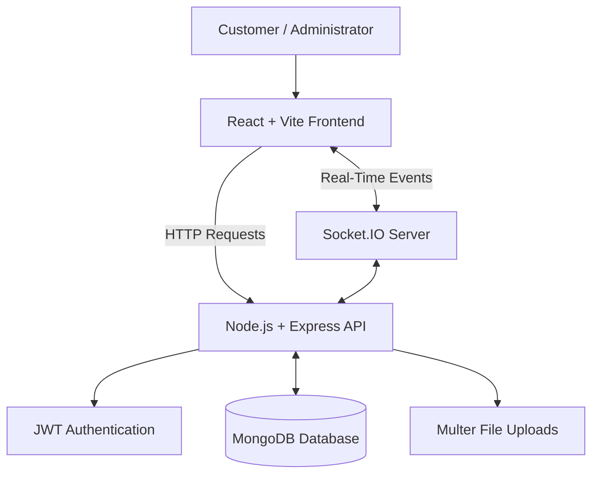

# 🛋️ Velaré Home — Full-Stack Furniture E-Commerce Platform

<p align="center">
  A modern, full-stack furniture shopping platform built to deliver an elegant and seamless online shopping experience.
</p>

<p align="center">
  <a href="https://valare-home-full-stack-website.vercel.app/">
    <strong>🌐 Live Demo</strong>
  </a>
  &nbsp; • &nbsp;
  <a href="#-features">Features</a>
  &nbsp; • &nbsp;
  <a href="#-tech-stack">Tech Stack</a>
  &nbsp; • &nbsp;
  <a href="#-getting-started">Getting Started</a>
</p>

<p align="center">
  
  
  
  
  
  
  
  
  
</p>

---

## 📖 Table of Contents

- [Overview](#-overview)
- [Features](#-features)
- [Tech Stack](#-tech-stack)
- [System Architecture](#-system-architecture)
- [Project Structure](#-project-structure)
- [Getting Started](#-getting-started)
- [Environment Variables](#-environment-variables)
- [Running the Application](#-running-the-application)
- [Deployment](#-deployment)
- [Security Considerations](#-security-considerations)
- [Future Improvements](#-future-improvements)
- [Contributing](#-contributing)
- [License](#-license)
- [Author](#-author)

---

## 🌟 Overview

**Velaré Home** is a full-stack furniture e-commerce web application that allows customers to explore, discover, and purchase furniture for their homes and offices.

The application combines a responsive React frontend with a Node.js and Express backend, using MongoDB for data persistence. Socket.IO enables real-time communication for order status updates.

The platform also includes an administrative dashboard for managing products, monitoring business analytics, and processing customer orders.

### 🎯 Project Objectives

- Deliver a modern and responsive online shopping experience.
- Simplify furniture discovery through search and filtering.
- Provide user authentication and role-based access control.
- Support product, inventory, and order management.
- Enable real-time order status updates.
- Demonstrate full-stack development and cloud deployment.

### 🌐 Live Demo

**[Visit Velaré Home](https://valare-home-full-stack-website.vercel.app/)**

---

## ✨ Features

### 🛍️ Customer Experience

- **Product Catalog:** Browse furniture collections for home and office spaces.
- **Advanced Filtering:** Filter products by category, price, color, and material.
- **Smart Search:** Search the product catalog and navigate to relevant products.
- **Product Details:** View product information, images, pricing, and specifications.
- **Shopping Cart:** Add products, update quantities, and manage cart items.
- **Wishlist:** Save favorite products for later.
- **User Authentication:** Register and log in to access personalized features.
- **User Profile:** Manage personal information and shipping addresses.
- **Order History:** Review previous orders.
- **Real-Time Order Tracking:** Receive order status updates through Socket.IO.
- **Product Reviews:** Submit ratings and written reviews as an authenticated user.
- **Toast Notifications:** Receive feedback for important actions.

### 🛡️ Admin Dashboard

- **Analytics Overview:** Visualize revenue trends, popular products, and customer growth.
- **Product Management:** Create, view, update, and delete products.
- **Image Uploads:** Upload product images through the backend.
- **Inventory Management:** Configure stock levels and product availability.
- **Order Management:** Review orders and update their statuses.
- **Customer Directory:** View registered customer information.
- **Real-Time Updates:** Notify customers of relevant order status changes.

### 🎨 Design and User Experience

- Responsive layouts for desktop, tablet, and mobile devices.
- Modern furniture-focused interface and product presentation.
- Tailwind CSS styling with custom utility classes.
- Velaré brand colors: `#DA4C2F` and `#1a2d5e`.
- Reusable UI components.
- Interactive elements and toast notifications.

### 🔐 Authentication and Security

- JWT-based authentication.
- Password hashing with `bcryptjs`.
- Role-based access for administrators and customers.
- Protected application features and API routes.

### ⚡ Real-Time Communication

Socket.IO supports communication between the server and connected clients.

When an administrator changes an order's status, the customer can receive the corresponding update without manually refreshing the page.

---

## 🧰 Tech Stack

### Frontend

| Technology | Purpose |
|---|---|
| React 19 | Component-based user interface |
| Vite | Development server and build tooling |
| Tailwind CSS | Responsive styling |
| React Router v6 | Client-side navigation |
| Lucide React | Icons |
| Recharts | Dashboard charts and analytics |
| React Context API | Shared application state |
| Socket.IO Client | Real-time client-server communication |

### Backend

| Technology | Purpose |
|---|---|
| Node.js | JavaScript runtime |
| Express.js | Backend framework and REST API |
| MongoDB | Database |
| Mongoose | MongoDB object modeling |
| JSON Web Token (JWT) | Authentication |
| bcryptjs | Password hashing |
| Multer | File upload handling |
| Socket.IO | Real-time communication |

### Deployment and Tools

| Technology | Purpose |
|---|---|
| MongoDB Atlas | Cloud database hosting |
| Vercel | Frontend deployment |
| Render | Backend deployment |
| Git | Version control |
| GitHub | Source code hosting |

---

## 🏗️ System Architecture

Velaré Home follows a client-server architecture that separates the frontend, backend API, database, and real-time communication layer.



### How It Works

1. **Frontend:** Customers and administrators interact with the React application.
2. **API Requests:** The frontend communicates with the Express backend.
3. **Authentication:** JWTs authenticate requests and support role-based access.
4. **Database:** MongoDB stores application data, including users, products, and orders.
5. **File Uploads:** Multer processes incoming product image uploads.
6. **Real-Time Communication:** Socket.IO delivers relevant order status updates.

---

## 📂 Project Structure

```text
Valare-Home-Full-Stack-Website/
│
├── Client/                         # React frontend
│   ├── public/                     # Static assets and images
│   ├── src/
│   │   ├── components/
│   │   │   ├── admin/              # Admin dashboard components
│   │   │   ├── common/             # Shared UI components
│   │   │   ├── home/               # Homepage components
│   │   │   └── layout/             # Header, footer, sidebar
│   │   ├── context/                # Shared state and providers
│   │   ├── pages/                  # Application pages
│   │   ├── services/               # API service functions
│   │   └── App.jsx                 # Application routes
│   └── package.json
│
├── Server/                         # Express backend
│   ├── controllers/                # Application business logic
│   ├── data/                       # Seed data
│   ├── db/                          # Database connection
│   ├── middlewares/                # Authentication and middleware
│   ├── models/                     # Mongoose schemas
│   ├── public/                     # Uploaded images
│   ├── routes/                     # API route definitions
│   ├── index.js                    # Server entry point
│   └── package.json
│
└── README.md
```

---

## 🚀 Getting Started

Follow these instructions to run Velaré Home locally.

### Prerequisites

Make sure you have installed:

- [Node.js](https://nodejs.org/) — version 18 or higher.
- [npm](https://www.npmjs.com/).
- [Git](https://git-scm.com/).
- A [MongoDB Atlas](https://www.mongodb.com/atlas) account or a local MongoDB instance.

### 1. Clone the Repository

```bash
git clone https://github.com/kenji-villa/Valare-Home-Full-Stack-Website.git
```

Navigate into the project directory:

```bash
cd Valare-Home-Full-Stack-Website
```

### 2. Set Up the Backend

Navigate to the backend directory:

```bash
cd Server
npm install
```

Create a `.env` file inside the `Server` directory.

Configure the variables described in the [Environment Variables](#-environment-variables) section.

### 3. Set Up the Frontend

Open a second terminal from the project root:

```bash
cd Client
npm install
```

Create a `.env` file inside the `Client` directory:

```env
VITE_API_URL=http://localhost:3001/api
```

This example assumes the backend runs on port `3001` and exposes its API under `/api`. Adjust it to match your application.

### 4. Start the Backend

From the `Server` directory, run:

```bash
npm run dev
```

### 5. Start the Frontend

From the `Client` directory, run:

```bash
npm run dev
```

Open the local URL displayed by Vite in your terminal.

### 6. Optional: Seed the Database

If your backend provides a seed script, run the following command from the `Server` directory:

```bash
npm run seed
```

Check the seed script before running it against a database containing existing data.

---

## 🔑 Environment Variables

### Backend — `Server/.env`

```env
PORT=3001

MONGO_URI=your_mongodb_connection_string

JWT_SECRET=replace_with_a_long_random_secret

CLIENT_URL=http://localhost:3000

ADMIN_EMAIL=admin@example.com

ADMIN_PASSWORD=replace_with_a_strong_password
```

| Variable | Description |
|---|---|
| `PORT` | Port on which the backend server listens |
| `MONGO_URI` | MongoDB connection string |
| `JWT_SECRET` | Secret used for JWT signing and verification |
| `CLIENT_URL` | Frontend origin used by the backend configuration |
| `ADMIN_EMAIL` | Administrator email, if supported by the application |
| `ADMIN_PASSWORD` | Initial administrator password, if supported by the application |

### Frontend — `Client/.env`

```env
VITE_API_URL=http://localhost:3001/api
```

| Variable | Description |
|---|---|
| `VITE_API_URL` | Base URL used by the frontend to communicate with the backend API |

**Security note:** Never commit `.env` files, database credentials, JWT secrets, or administrator passwords to GitHub. Variables prefixed with `VITE_` are exposed to client-side code and must not contain secrets.

---

## ☁️ Deployment

The application is deployed using **Vercel for the frontend** and **Render for the backend**.

### Frontend Deployment — Vercel

1. Import the GitHub repository into [Vercel](https://vercel.com/).
2. Configure the project to use the `Client` directory as its root directory.
3. Set the appropriate build command and output directory for Vite.
4. Configure the production environment variable:

   ```env
   VITE_API_URL=https://your-render-backend.onrender.com/api
   ```

5. Deploy the frontend and verify that API requests work correctly.

### Backend Deployment — Render

1. Create a web service on [Render](https://render.com/).
2. Connect your GitHub repository.
3. Configure the service to use the `Server` directory as its root directory.
4. Set the appropriate build and start commands from `Server/package.json`.
5. Configure the required environment variables:

   ```env
   MONGO_URI=your_production_mongodb_connection_string
   JWT_SECRET=your_production_jwt_secret
   CLIENT_URL=https://valare-home-full-stack-website.vercel.app
   ```

6. Add any other variables required by the backend.
7. Confirm that the backend can connect to MongoDB and that the frontend can access the API.

### Production Checklist

- [ ] Frontend uses the deployed backend API URL.
- [ ] Backend CORS configuration allows the production frontend origin.
- [ ] MongoDB permits connections from the backend hosting environment.
- [ ] Production secrets are configured securely.
- [ ] Uploaded images are accessible in production.
- [ ] Authentication and protected routes work correctly.
- [ ] Real-time order updates work correctly.

### Live Application

**[https://valare-home-full-stack-website.vercel.app/](https://valare-home-full-stack-website.vercel.app/)**

---

## 🔒 Security Considerations

- Keep `.env` files out of version control.
- Store passwords as hashes rather than plaintext.
- Use strong, unique production secrets.
- Validate incoming data on the backend.
- Protect administrator routes with authentication and authorization.
- Configure CORS for trusted frontend origins.
- Validate uploaded file types and sizes.
- Avoid committing database credentials, tokens, or private customer information.

---

## 🔮 Future Improvements

Potential future enhancements include:

- Online payment gateway integration.
- Automated order confirmation emails.
- Personalized product recommendations.
- Low-stock alerts and advanced inventory reporting.
- Automated frontend and backend testing.
- Dedicated cloud storage for product images.
- Search engine optimization and performance monitoring.
- Expanded sales analytics and reporting.

---

## 🤝 Contributing

Contributions, suggestions, bug reports, and feature requests are welcome.

### How to Contribute

1. Fork the repository.
2. Create a feature branch:

   ```bash
   git checkout -b feature/your-feature-name
   ```

3. Make your changes and test them.
4. Commit your changes:

   ```bash
   git commit -m "Add: describe your changes"
   ```

5. Push your branch:

   ```bash
   git push origin feature/your-feature-name
   ```

6. Open a pull request describing your changes.

---


## 📄 License

This project is licensed under the [MIT License](LICENSE).

You are free to use, copy, modify, distribute, and sublicense this software, subject to the terms and conditions of the MIT License.


---

## 👨‍💻 Author

**Velaré Home — Full-Stack Web Development Project**

- **GitHub Repository:** [Valare-Home-Full-Stack-Website](https://github.com/kenji-villa/Valare-Home-Full-Stack-Website)
- **Live Application:** [Velaré Home](https://valare-home-full-stack-website.vercel.app/)

---

<p align="center">
  <strong>Velaré Home</strong>
  <br />
  Bringing comfort, style, and convenience to online furniture shopping.
  <br /><br />
  Built with ❤️ using React, Node.js, Express, MongoDB, and Socket.IO.
</p>
